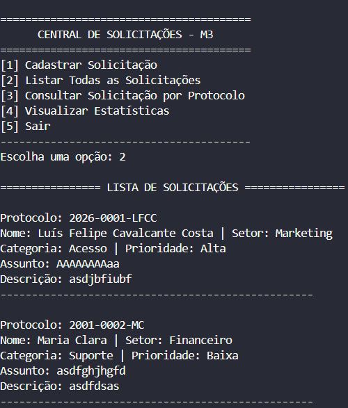

<div align="center">

# Central de Solicitações · Luís Felipe

**Rascunho de Projeto em Pyhton**


Trilha de Formação em Desenvolvimento de Soluções com IA · [Projetar Soluções](https://github.com/Projetar-Solucoes)

</div>

---

## Sobre o projeto

A Central de Solicitações permite cadastrar pedidos de suporte divididos por setores, categorias e prioridades, gerando um protocolo único baseado no ano, número sequencial e iniciais do usuário. Todos os dados são salvos de forma persistente em um arquivo JSON para que nenhuma informação seja perdida.

<div align="center">



</div>

## Como rodar

**Você vai precisar de:** Python 3 instalado.

```bash
# 1. Baixe o projeto
git clone https://github.com/Projetar-Solucoes/[nome-do-seu-repositorio].git
cd [nome-do-seu-repositorio]

# 2. Rode a Central
python semana-03/central.py
```

## O que já funciona

- [x] [Cadastrar uma solicitação]
- [x] [Listar as solicitações]
- [x] [Cadastrar e registrar várias solicitações.]
- [x] [Gerar número de protocolo]
- [ ] [Alterar solicitação]
- [ ] [Excluir solicitação]
- [ ] [Exportar dados para CSV]

## Como o projeto está organizado

| Pasta | O que tem |
|---|---|
| `semana-01/` | Primeiros programas: [ola.py, cartão, ficha, orçamento] |
| `semana-02/` | [Menu, validações e relatórios] |
| `semana-03/` | [Código em funções e módulos, com dados salvos em JSON] |
| `semana-04/` | [Análise dos dados com Pandas] |
| `imagens/`   | Prints usados neste README |

## O que aprendi

- **Semana 1:** [Aprendi a ler dados do teclado, estruturar entradas e organizar os primeiros programas básicos em Python.]
- **Semana 2:** [Desenvolvi estruturas de controle, menus interativos, validações robustas e tratamento de erros de entrada.]
- **Semana 3:** [Apliquei modularização dividindo o código em funções e arquivos separados, além de implementar persistência de dados com JSON.]
- **Semana 4:** [Em breve: Análise e manipulação dos dados utilizando Pandas e Gestão de Versionamento de Código pelo Git e GitHub]

## Tecnologias

- Python 3
- Git e GitHub
- Pandas

---

<div align="center">

Feito por **Felipe Cavalcante** · [@felps799](https://github.com/felps799)

</div>
